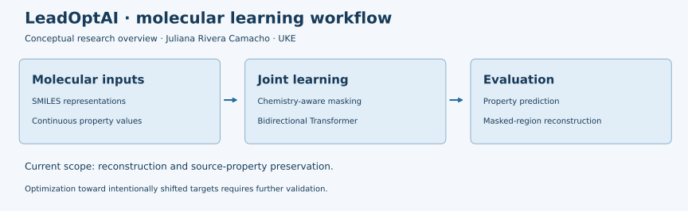

# LeadOptAI

**Molecular property modeling and chemistry-aware learning for lead-optimization research**

**Juliana Rivera Camacho · M.Sc. Molecular Life Sciences · Universität Hamburg**  
**Research setting:** Universitätsklinikum Hamburg-Eppendorf (UKE) · Master’s thesis project

LeadOptAI investigates how molecular structure and continuous physicochemical properties can be learned jointly to support research into property-aware molecular editing. The project combines a bidirectional SMILES Transformer with chemistry-informed reconstruction tasks.

**Public project overview:** this repository contains documentation and an implementation map. Source code, trained weights, datasets, detailed training configurations and unpublished results remain in the private research repository while the work is prepared for publication.

## Scientific motivation

How can a molecular model connect chemical context with physicochemical properties when reconstructing a selected region of an existing molecule?

Lead optimization involves balancing several properties while considering which structural features should be retained or modified. LeadOptAI explores a computational foundation for this problem through joint molecular-property prediction and masked-region reconstruction.

## Project at a glance

| Research focus | Approach | Relevance to discovery research |
| --- | --- | --- |
| Structure–property learning | Joint representation of SMILES and continuous numerical descriptors | Learning relationships between chemical structure and physicochemical profiles |
| Molecular-property modeling | Property-specific regression alongside molecular reconstruction | Multi-task learning and evaluation of molecular representations |
| Localized molecular editing | Reconstruction of selected masked SMILES regions using surrounding context | Investigation of edits to existing molecules |
| Chemical knowledge | Functional-group and BRICS masking alongside token and block masking | Reconstruction tasks at multiple structural scales |
| Experimental evaluation | Baseline comparisons and masking/feature experiments | Assessing model behavior and the contribution of design choices |

## My contribution

I translated the research question into a molecular machine-learning workflow, including:

- **Molecular data preparation:** processing SMILES and associated numerical property information for modeling.
- **Model development:** implementing a bidirectional Transformer with separate discrete and continuous embeddings and joint prediction objectives.
- **Chemistry-informed learning:** implementing functional-group and BRICS masking using RDKit alongside conventional sequence masking.
- **Training and evaluation:** developing training/validation workflows, comparing molecular language-model baselines and investigating experimental variants.
- **Scientific analysis:** visualizing performance, interpreting results and communicating findings and limitations.

## Approach and workflow

*Conceptual overview only; no unpublished numerical results or implementation parameters are shown.*

1. **Prepare molecular inputs:** process SMILES and associated continuous descriptors.
2. **Build joint representations:** embed discrete tokens and numerical property values in a shared model.
3. **Apply reconstruction tasks:** combine conventional masking with functional-group and BRICS masking.
4. **Train and evaluate:** jointly predict masked tokens and properties, compare baselines and examine experimental variants.
5. **Interpret molecular edits:** assess reconstruction and property-profile preservation within the evaluated setup.

### Chemistry-aware masking

Masking recognizable functional groups and BRICS fragments asks the model to reconstruct chemical units from their molecular context. Combined with individual-token and contiguous-block tasks, it provides learning objectives at complementary structural scales. The project investigates whether this chemical organization offers useful information for molecular representation learning and property-aware editing research.

### Physicochemical properties

The project considers six descriptors relevant to characterizing molecular profiles:

| Descriptor | Information represented |
| --- | --- |
| Molecular weight | Molecular size by mass |
| LogP | Lipophilicity |
| Rotatable bonds | A descriptor of molecular flexibility |
| Topological polar surface area (TPSA) | Polar surface contribution |
| Hydrogen-bond donors (HBD) | Hydrogen-bond donation capacity |
| Hydrogen-bond acceptors (HBA) | Hydrogen-bond acceptance capacity |

These descriptors are modeled as continuous numerical values. They characterize physicochemical properties; they do not by themselves establish potency, selectivity, toxicity or a complete ADMET profile.

## Technical stack

**Python · PyTorch · RDKit · Transformer encoders · Multi-task learning · SMILES · SMARTS · BRICS**

The work combines molecular-data processing, custom neural components, training workflows, baseline evaluation and scientific interpretation. It provides evidence of hands-on molecular ML research relevant to computational drug discovery and molecular-property modeling.

## Evidence and interpretation

The research evaluates property prediction and molecular reconstruction and includes comparisons with molecular language-model baselines. Detailed numerical results and experimental configurations are reserved for the research publication.

The evaluated infilling setup uses the source molecule’s property values. It therefore examines **reconstruction and source-property preservation**. Successful optimization toward deliberately shifted property targets remains a separate validation task.

Further research should evaluate scaffold generalization, the quality and size of molecular edits, performance toward changed property targets, and downstream biological or structure-based assessments.

## Repository guide

See [CODE_STRUCTURE.md](CODE_STRUCTURE.md) for the main files and responsibilities in the private implementation. This is a documentation map; the listed Python files are not distributed in this public repository.

## Research context and collaboration

LeadOptAI is research intended for scientific publication. Please acknowledge the researchers’ contributions and contact the author to discuss collaboration or unpublished material. Publication and future release information will be added when available.

This overview does not grant access to the private implementation or introduce a license for it. Third-party rights remain applicable.

**Juliana Rivera Camacho** · Hamburg, Germany  
[GitHub profile](https://github.com/julianariveracamacho)

